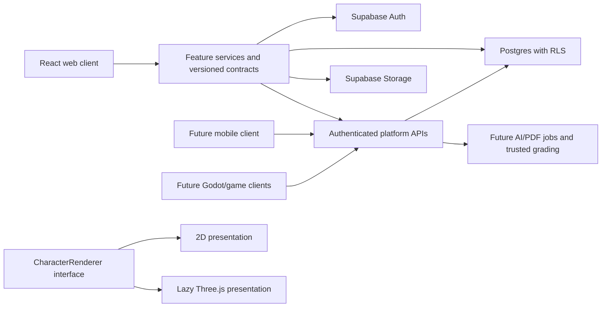

# Language-learning platform: foundation plan

Status: first-phase implementation plan, 28 September 2026. Working name: **Kotoba** (replaceable branding).

## Reference and design direction

No reference image was included with the supplied text. This is an interpretation of the written brief, not an image analysis. An image review should refine the visual tokens before a final brand/design sign-off.

Use a warm ivory canvas, charcoal navigation and dialogue scenes, muted moss accents, fine borders, and restrained terracotta highlights. Pair an editorial serif for expressive headings with a highly readable sans-serif for controls and body copy. Use an 8px spacing rhythm, modest 12–20px panel radii, generous whitespace, clear information hierarchy, and Material Symbols. Keep learning screens practical; use larger character compositions, chapter numbering, scene captions, and cinematic framing in story areas. Initial character artwork is explicitly a placeholder, not a production avatar asset.

Support desktop sidebar navigation, a collapsible mobile navigation menu, semantic landmarks, visible focus rings, labeled inputs, reduced motion, and accessible feedback. Color never communicates status alone. Loading, empty, error, locked, unavailable, and completed states are explicit.

## Product phases

| Stage | Scope |
| --- | --- |
| First foundation (this implementation) | React app, public/app/admin layouts, first pages, Supabase Auth integration, SQL migrations/RLS/seed, portable avatar contract, 2D renderer and lazy 3D placeholder, reusable exercise architecture, labeled mock catalogs and progression, admin template prototype, documentation |
| MVP release | Wire catalog/progress services to the database, audited lesson grading and XP transactions, profile/avatar persistence, real course content, tested admin publishing, accessibility audit, account lifecycle flows, monitoring and release validation |
| Phase 2 | Validated AI provider adapter, bounded conversation memory and relationships, template-driven PDF jobs, playable web games and verified score submission, achievements/quests/streak reward rules, social privacy controls |
| Phase 3 | Moderated realtime study rooms, broader opportunity/tour catalogs, richer character assets and story content, voice after privacy/moderation design, mobile client |
| Long-term RPG ecosystem | Godot/mobile authentication, shared versioned avatar/inventory API, server-authoritative cross-game progression, asset manifests and compatibility mapping, open-world RPG |

The first foundation is not the production MVP. Sample content must remain labeled; offline/demo data must never silently stand in for a failed live backend request.

## System boundaries



- **Auth account:** `auth.users` owns credentials, verified email, and sessions. Never copy credentials or private email into public profiles.
- **Player profile:** public display identity and explicit visibility; role assignments are protected separately.
- **Avatar/MC:** many avatars per player, at most one primary avatar; portable versioned asset references, colors, and proportions. No renderer objects or website component names in saved definitions.
- **Language progression:** one record per user/language plus per-skill progress. Account XP, game scores, and CEFR proficiency are distinct measures. XP must not automatically certify CEFR.
- **Game progression:** verified sessions and results reference game/version/language. Clients eventually submit evidence, never authoritative XP amounts.
- **Character relationship:** per-user/per-character affinity and scenario state, separate from conversations and avatars.

React local state handles forms and interactions; Auth Context handles session state. Feature services own remote queries and mock adapters. No Redux or server-state dependency until cache/invalidation requirements justify one. Start with JavaScript and JSDoc for portable contracts; runtime validation is still necessary at every trust boundary.

## Routes

| Area | Initial routes | Later extension |
| --- | --- | --- |
| Public | `/`, `/games`, `/games/:gameId`, `/opportunities` | `/features`, `/about` |
| Auth | `/auth/login`, `/auth/register`, `/auth/reset-password`, `/auth/update-password`, `/auth/callback` | MFA and account recovery policy |
| Learning | `/app`, `/app/dashboard`, `/app/learn`, `/app/course/:courseId`, `/app/lesson/:lessonId` | language overview, additional exercise types |
| Games | `/app/games`, `/app/games/:gameId`, `/app/leaderboards` | game-specific rankings and release history |
| Characters | `/app/ai/characters`, `/app/ai/characters/:characterId`, `/app/ai/conversation/:characterId` | durable server session IDs once persistence is wired |
| Player | `/app/avatar`, `/app/profile/:username`, `/app/achievements`, `/app/settings` | inventory and customization expansion |
| Discovery | `/app/opportunities`, `/app/rooms`, `/app/library` | tour details and generated PDFs |
| Admin | `/admin`, `/admin/pdf-templates` | section-specific CRUD as content is connected |

ProtectedRoute waits for auth initialization. AdminRoute obtains authority from server-managed roles, never editable user metadata. A separately labeled demo session is available only when demo mode is explicitly enabled and no live Supabase configuration is present. Demo administration edits sample data only and grants no backend role.

## Frontend structure

```text
src/
  app/                  # routing and application providers
  components/ui/        # reusable semantic UI primitives
  layouts/              # PublicLayout, AppLayout, AdminLayout
  pages/                # landing and fallback pages
  features/
    auth/               # AuthProvider, guards, auth pages
    learning/           # course and lesson presentation
    exercises/          # ExerciseRenderer and type implementations
    avatar/             # preview, selectors, portable definition
    characters/         # renderer abstraction and character catalog
    aiConversations/    # presentation independent of provider
    games/              # catalog and details
    leaderboard/
    achievements/
    quests/
    opportunities/
    rooms/
    profile/
    admin/
    pdfs/
  three/scenes/         # lazy Canvas and placeholder viewer
  lib/                  # environment and Supabase client
  services/             # data access boundaries
  data/                 # sample catalogs separate from UI
  styles/               # tokens and shared visual rules
supabase/
  migrations/           # ordered schema, policies, storage
  seed.sql              # development fixtures only
  tests/                # policy and integrity checks
docs/                   # decisions, setup, contracts, roadmap
```

Create modules when they contain behavior, not dozens of empty folders. Heavy routes and the entire 3D renderer load on demand. No GLB or game executable is part of the ordinary dashboard bundle.

## Database architecture

Use UUID primary keys, UTC timestamps, foreign keys, indexed ownership/join columns, unique natural keys, bounded numeric values, and JSON shape checks. Use JSONB only for versioned heterogeneous content/configuration, not routine relational links.

| Domain | Relations and responsibility |
| --- | --- |
| Identity | profiles, private player settings, protected user roles; automatic signup provisioning |
| Learning catalog | languages → courses → units → lessons → exercises; exercise type and content version are data |
| Learning results | user-language progress, skill progress, lesson progress; server-owned awards and proficiency |
| Player rewards | account progress, append-only XP ledger, streak activity, achievement definitions/unlocks, quest definitions/progress |
| Avatars | avatar assets, avatars, inventory and equipped asset references; compatibility and entitlement enforced on write |
| Games | games, game versions, game-language support, verified sessions/results; future idempotent submission boundary |
| Characters | characters, scenarios, relationships, conversation sessions; bounded metadata and private history strategy |
| Materials | versioned educational templates and generated-material job metadata; private storage object references |
| Discovery | opportunities with typed category and requirements, tour details attached only where relevant |
| Community | rooms and memberships; qualification checked server-side before future participation |
| Operations | notifications, moderation reports, platform configuration with protected writes |

### Relationships and deliberate limits

A course belongs to one language. Units belong to courses, lessons to units, exercises to lessons, with stable positions unique within each parent. Results reference catalog IDs, not copied titles. Avatar ownership references profiles; asset catalog entries can carry render variants for web/Godot/mobile. Character dialogue refers to stable character and scene IDs, while presentation state uses allowlisted emotion/pose/animation keys.

Opportunity types share a common catalog; do not create separate tables for every marketing category. Add a tour extension only for itinerary/date/capacity-specific data. Leaderboards are projections over trusted results with visibility controls, not independently editable score records. Snapshot/period ranking jobs can be introduced when scale needs them. Do not create voice, payment, booking, or RPG-world tables prematurely.

Progress aggregation may be intentionally denormalized for reads, but the trusted activity/XP ledger is the audit source. A future award transaction validates evidence, deduplicates by source event, appends the ledger, and updates aggregates atomically. Streaks need user timezone, one qualifying day per local date, and auditable freeze usage. These reward algorithms are not faked in the live client.

### Security model

Enable RLS on every exposed relation and explicitly restrict table grants. Published catalog reads are public; unpublished child content must also respect parent publication. Users can edit safe profile fields and their own valid avatar configuration. Owners can read private progress, conversations, materials, and notifications. Clients cannot award XP, elevate roles, unlock cosmetics, set verified scores, or change moderation decisions.

Use a protected role table and a narrowly scoped role helper with a fixed search path. Role grants require a trusted operator. Do not trust `raw_user_meta_data` for authorization. Admin UI gates improve usability; RLS and privileges provide security. Private data is not exposed through permissive views. Template publishing, leaderboard visibility, report submission, and storage paths each need explicit policies.

Separate public exercise prompts from protected answers before enabling scored assessments. Sample exercises may include answers for client-only practice, which must not award trusted XP. Future external-game endpoints validate authenticated ownership, version, input limits, nonce/replay protection, and scoring evidence.

### Storage

Public curated assets: character art, approved model/texture variants, game covers/screenshots, opportunity art. Admin-only uploads, bounded size/type restrictions. User images: authenticated owner path (`user-id/...`), with deliberate public visibility if used as public portraits. Generated PDFs/private uploads: private bucket, owner access and short-lived signed download URLs. Never store signed URLs as permanent records. No secret/service-role key in a Vite variable.

## First implementation behavior and mocks

Real foundation: routing, responsive navigation, auth adapter/forms/session/guards, environment handling, reusable components, renderer switching, mock exercise interaction, portable avatar export, and SQL artifacts. If Supabase is configured, auth uses it and errors remain errors.

Initially mocked: progress/reward figures, rankings, game catalog availability, opportunities, AI character text, relationship gains, PDF generation and admin preview content. Sample opportunities are fictional and have no real application/booking action. Character replies are scripted and labeled as such; no AI provider is contacted. A template preview is not represented as a generated production PDF. Persistence behavior must be explained per feature.

## Dependencies and setup rationale

Runtime packages only: `react`, `react-dom`, `react-router` (navigation), `@supabase/supabase-js` (auth/data boundary), `three`, `@react-three/fiber`, `@react-three/drei` (requested optional 3D preview). Development: `vite`, `@vitejs/plugin-react`, `tailwindcss`, `@tailwindcss/vite`. Material Symbols and fonts use CSS font resources, not an icon library. Use Node's built-in test runner for pure contract tests. No AI SDK, PDF engine, Redux, UI kit, or game engine in this phase.

React 19 pairs with Fiber 9. Tailwind uses its Vite plugin. Start from the Vite React template in a new directory, then add only the listed packages; exact reproducible project commands belong in README. Vercel must rewrite SPA deep links to `index.html`, and auth redirect URLs must be configured per deployment.

## Validation and release gates

Run install, production build, meaningful contract tests, responsive browser smoke checks, auth guard/deep-link checks, and database migration/seed/RLS tests. Verify anonymous, owner, other-user, and admin behavior, including denied role/XP writes. Never claim hosted auth or database verification without a configured Supabase project/runtime. Deployment is a separate operation, not implicit in scaffolding.

## Future TODOs

- Avatar: full creator, validated body/model compatibility, morph targets, reusable skeletons, clothing swaps, inventory, facial animations, lip sync, and version migrations.
- Characters: provider-independent structured AI output, safe state allowlists, bounded server-side memory, relationship/story progression, text-to-speech, consent-aware voice.
- Games/RPG: signed-in Godot clients, portable appearance reconstruction, game API, verified cross-game rewards, client compatibility, open-world RPG.
- Community: moderation and qualification-aware realtime rooms, voice/video/livestreaming.
- Platform: mobile app, background PDF jobs, tour booking, payments, content moderation operations, observability, retention/export/deletion policies.

## Official implementation references

- [Vite setup and Node requirements](https://vite.dev/guide/)
- [React Router declarative setup](https://reactrouter.com/start/declarative/installation)
- [Tailwind Vite integration](https://tailwindcss.com/docs/installation/using-vite)
- [Supabase client initialization](https://supabase.com/docs/reference/javascript/initializing)
- [Supabase row-level security and grants](https://supabase.com/docs/guides/database/postgres/row-level-security)
- [React Three Fiber compatibility](https://r3f.docs.pmnd.rs/getting-started/installation)
